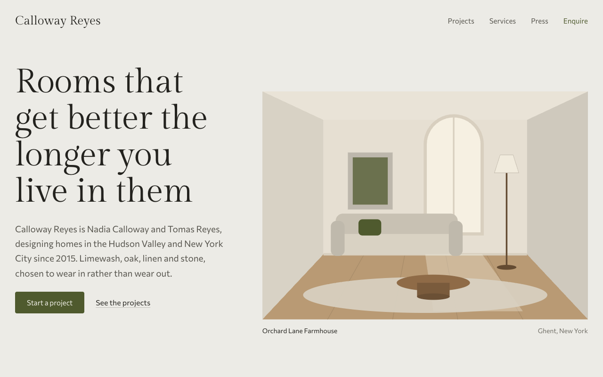

# Calloway Reyes: Astro interior design website template

An interior designer's website with large project galleries, services and fees, the design process, press, and an enquiry form. Static, fast, and no server needed.



[](https://console.cloudzyro.com/new?repo=https://github.com/Cloudzyro/template-interior-design)

## What's included

- Home page with a large room picture, selected projects at different sizes, how the studio works, the process, a press quote and an enquiry prompt
- Projects page laid out like a portfolio, and a page per project with a large gallery (previous and next buttons, thumbnails and arrow keys), the brief, scope, material swatches and who it was made with
- Services and fees page (full-service design, room refresh, consultation) with the process step by step
- Press page (fictional publications, clearly marked) and an enquiry form: project type, location, rooms, budget range, timeline and a message
- Structured data (schema.org), Open Graph tags, sitemap, robots.txt, favicon and a 404 page
- Responsive down to 360px, keyboard friendly, reduced motion respected
- Room pictures are drawn in SVG from each view's colors, so there are no photos to license

## Run it locally

```bash
pnpm install
pnpm dev        # http://localhost:4321
pnpm build      # static site in dist/
pnpm preview
```

## Make it yours

- **Content:** everything is in `src/data/site.ts`: the studio, projects, services and fees, process, press and the enquiry form's options. Fees and press are samples; replace them with your own.
- **Projects:** each project has a brief, scope, materials (name and color for the swatch), credits and a `gallery` of views. A view has a `kind` (living, kitchen, bedroom, bath, dining or hall), a caption and a palette, drawn by `src/components/RoomScene.astro`. `cover` picks which view stands for the project in lists.
- **Your own photos:** replace `RoomScene` with an `` (or Astro's `<Image>`) in `src/pages/index.astro`, `src/pages/projects/index.astro` and `src/pages/projects/[slug].astro`, and put your files in `src/assets/` or `public/`.
- **Enquiry form:** set `PUBLIC_FORM_ENDPOINT` to a form endpoint from Formspree, Basin, a Supabase function or similar. The form sends `name`, `email`, `project_type`, `location`, `rooms`, `budget`, `timeline` and `message` as form data. With no endpoint set, the form shows a short note and opens the visitor's email app addressed to the email in `src/data/site.ts`.
- **Site address:** set `SITE_URL` (for example `https://www.callowayreyes.com`) so the sitemap, canonical links and social previews use your domain.
- **Colors and fonts:** colors are CSS variables at the top of `src/styles/global.css`. Fonts are Gilda Display for headlines and Commissioner for everything else, self-hosted with Fontsource and imported in `src/layouts/Base.astro`.
- **Social preview image:** replace `public/og.png` (1200 x 630).

Environment variables are read at build time. Locally, put them in `.env` (see `.env.example`):

```bash
PUBLIC_FORM_ENDPOINT=https://formspree.io/f/your-id
SITE_URL=https://www.callowayreyes.com
```

## Deploy

Click the Deploy button above, or push your own copy to GitHub and connect it in the Cloudzyro console. Add the environment variables in your site's settings. The build command is `pnpm build` and the output folder is `dist/`, a plain static site.

## Stack

- Astro 7 (static output)
- @astrojs/sitemap
- Fontsource (Gilda Display, Commissioner)
- TypeScript, plain CSS

MIT licensed. See [LICENSE](./LICENSE).
